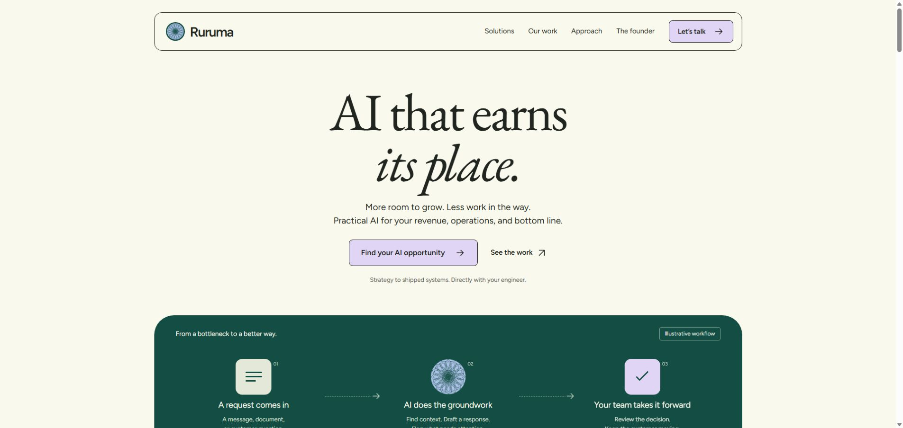
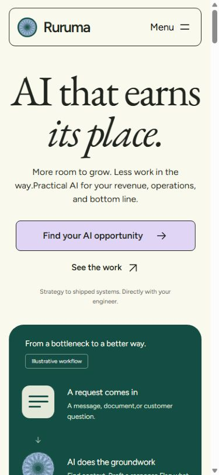
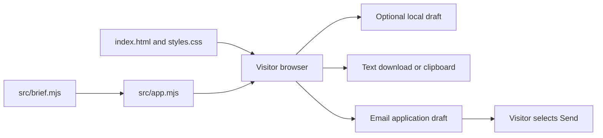
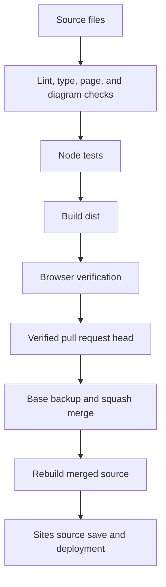

# Ruruma

[](https://github.com/kandulanikhilvarma/ruruma/actions/workflows/ci.yml)
[](LICENSE)

Ruruma is the AI engineering brand of Nikhilvarma Kandula.
The website presents practical services for revenue growth, process efficiency, and lower costs.
Visitors can explore a use case, inspect founder work, and create a project brief.

[Website](https://ruruma.sassyglobe34.chatgpt.site) · [Project source](https://github.com/kandulanikhilvarma/ruruma) · [Deployment notes](docs/DEPLOYMENT.md)

## First release

- Six industries and three business outcomes, with 18 service paths.
- A catalog of AI strategy, engineering, automation, knowledge, evaluation, and cost services.
- Verified founder background and links to Witness, Ganymede, and FirstChair.
- A validated brief with text download, clipboard copy, and an encoded email draft.

- Optional draft storage on the visitor's device.
- Mobile navigation, keyboard focus, reduced motion, and clear form errors.
- Privacy information, accessible contact, and recovery for unknown routes.

Ruruma is a public brand website.
The site has no client accounts, payment flow, or server intake.
The website does not call an AI model or connect to visitor business tools.
Email delivery happens only when the visitor sends the draft in their email application.

## Screenshots

Desktop:



Mobile:



## Local setup

Use Node.js 24 LTS and npm.
The application has no production package dependencies.
Development packages support lint, type checks, HTML checks, and Mermaid validation.

```sh
git clone https://github.com/kandulanikhilvarma/ruruma.git
cd ruruma
npm ci --ignore-scripts
npm run dev
```

Open the printed URL, `http://127.0.0.1:4173`.
The preview listens only on the local device.
Rebuild after each source edit.
Reload the page.

```sh
npm run build
```

For a preview of an existing build:

```sh
npm run preview
```

## Core workflow

1. Select an outcome in Solutions.
2. Select an industry.
3. Inspect the proposed scope, measures, and limits.
4. Select **Build a brief for this**.
5. Enter the company, email, and workflow details.

6. Select **Create my brief**.
7. Review the brief.
8. Download the file or open the email draft.
9. If you choose email, review the message in your email application.
10. Select Send in that application.

The website never reports that the founder received a brief.
Long email drafts can exceed application limits.
Download the file and attach it to an email if the draft does not open.

## Configuration

The site needs no API keys or environment secrets.

| Name | Use |
| --- | --- |
| `SITE_URL` | HTTPS origin for canonical URLs, social metadata, robots, and the sitemap. |
| `SOURCE_COMMIT` | Source SHA for the public release record. The build otherwise reads Git HEAD. |

The default origin is the approved Sites address.
Set `SITE_URL` before a build for another host or domain.
Do not put credentials in this value.
The build rejects paths, query parameters, and credentials in the origin.

Update `CONTACT_EMAIL` in `src/brief.mjs` and the visible email links together if the contact address changes.
The logo source is `assets/logo-original.svg`.
The cropped `logo.svg` and `mark.svg` preserve its paths and colors.
Fonts load from `assets/fonts`; their OFL licenses reside there.

## Architecture

The site uses semantic HTML, CSS, and browser JavaScript modules.
The stack keeps the website portable without a framework runtime.
Node.js builds an allowlisted static output in `dist`.
Only development checks need npm packages.



The website has no server database.
Each browser profile owns its local draft.
The local storage key is `ruruma-project-brief-v1`.
The tool checks draft age on load and removes drafts older than 30 days.
The visitor can clear the draft at any time.



## Project structure

```text
index.html               Public brand page
privacy.html             Data handling and accessibility
404.html                 Missing-page recovery
styles.css               Responsive visual system
src/app.mjs              Browser UI and optional draft storage
src/brief.mjs            Validation, suggestions, text export, and mailto
assets/                  Logo, fonts, licenses, and social image
scripts/                 Build, safe preview, page checks, and diagram checks
tests/brief.test.mjs      Brief logic and boundary tests
docs/                    Research, deployment, roadmap, and screenshots
.openai/hosting.json      Sites identity and static output declaration
vercel.json              Vercel build and security header configuration
```

## Verification

Run the complete source checks and tests before a release.

```sh
npm run check
npm test
npm run build
npm audit --audit-level=low
```

The source gate checks JavaScript syntax, page metadata, labels, anchors, and local resources.
TypeScript checks the JavaScript modules without an emitted build.
Mermaid parses every diagram in Markdown.
Tests cover field limits, Unicode, email validation, allowlists, and all service combinations.
CI runs the source checks, tests, and build on pushes and pull requests.

Browser verification must cover the complete brief workflow and optional draft recovery.
Check the draft clear action, mobile navigation, and errors.
Read `docs/VERIFICATION.md` for the release evidence and its limits.
The build writes `release.json` with the source commit.
Compare that SHA with the merged GitHub commit after deployment.

The supplied GitHub hygiene archive lacks its helper scripts.
The release uses direct commands for equivalent repository checks.
No absent helper ran.
The STE checker covers authored Markdown.
The checker does not include the approved ASD dictionary.
The author does not claim formal STE compliance.

## Hosting and activation

The approved first host is free Sites hosting.
The intended custom domain is `ruruma.me`.
Domain ownership, DNS, and TLS activation need separate verification.
The first deployment does not assert custom-domain activation.

Vercel configuration is ready, but no Vercel deployment is part of this release.
The connected account reported Hobby.
[Vercel requires a paid plan for commercial use](https://vercel.com/docs/limits/fair-use-guidelines#commercial-usage).
The team metadata API also returned a scope-access error.
Do not start a paid plan without the owner's approval.
Follow [deployment notes](docs/DEPLOYMENT.md) for the exact activation steps.

## Product evidence and scope

The public research covers 25 founder repositories and Kandula Studio.
The selected projects show the founder's work, not Ruruma client outcomes.
Ganymede results describe a backtest.
FirstChair is a pre-launch MVP.
The website does not invent customers, testimonials, or revenue figures.

The supplied REA archive informed the evidence method.
Its code did not run and its MCP engine was unavailable.
Wispr Flow informed the palette, type scale, and curved section treatment.
Ruruma uses original copy, layouts, workflow visuals, and the supplied logo.
See [research](docs/RESEARCH.md), [product scope](PRODUCT.md), and [roadmap](docs/ROADMAP.md).

## Contribute and report issues

Read [CONTRIBUTING.md](CONTRIBUTING.md) before a change.
Report security concerns through the private contact in [SECURITY.md](SECURITY.md).
Do not include visitor drafts or private project data in public issues.

## License

Code uses [Apache-2.0](LICENSE).
Copyright 2026 Nikhilvarma Kandula.
The license does not grant trademark rights in Ruruma.
See [NOTICE](NOTICE) for brand and font notices.

[LinkedIn](https://www.linkedin.com/in/nikhilvarmakandula) · [Email](mailto:kandulanikhilvarma@gmail.com) · [Portfolio](https://kandula.studio)
